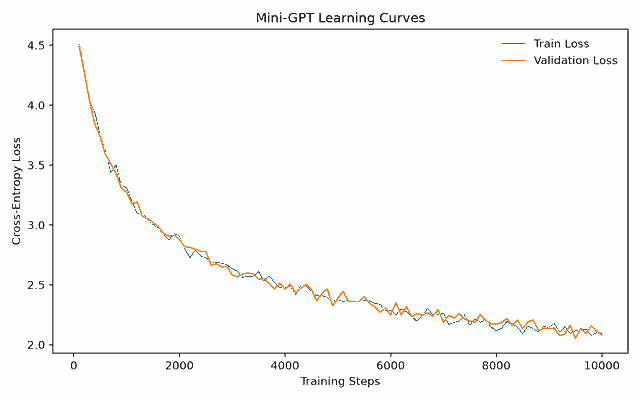

# Mini-GPT from Scratch

A small **decoder-only Transformer language model** implemented and trained from random initialization with PyTorch on [TinyStories](https://huggingface.co/datasets/roneneldan/TinyStories).

This project covers the full pipeline: tokenizer training, GPT architecture, next-token pretraining, loss evaluation, checkpointing, and text generation.

## Features

- Byte-level **BPE tokenizer** with an 8,000-token vocabulary
- **Causal multi-head self-attention**, learned positional embeddings, pre-LayerNorm Transformer blocks, and GELU feed-forward layers
- **Next-token prediction** trained with AdamW and cross-entropy loss
- **Training/validation loss** tracking, CSV logging, and Matplotlib visualization
- **Autoregressive generation** with temperature sampling and EOS stopping
- **Checkpoints** containing model weights, optimizer state, and model configuration

## Model configuration

| Setting | Value |
| --- | --- |
| Dataset | TinyStories |
| Vocabulary size | 8,000 (byte-level BPE) |
| Context length | 256 tokens |
| Transformer blocks | 8 |
| Embedding dimension | 512 |
| Attention heads | 8 |
| FFN hidden dimension | 2,048 |
| Batch size | 8 |
| Optimizer | AdamW |
| Learning rate | 3e-4 |
| Training steps | 10,000 |

## Results

Both training and validation cross-entropy loss decreased to **approximately 2.1** after 10,000 training steps, with no clear divergence between the two curves.



Example generated text (unfiltered):

> Once upon a time, there was a delicious pepper. Sally paid through red fabric. It taught Blue every day and playing with her finger...

The model learns English sentence patterns, although longer stories are not yet consistently coherent.

## Quick start

Requires Python 3.10+ and PyTorch. A CUDA GPU is recommended for training.

```bash
git clone https://github.com/Manstein0704/mini-GPT.git
cd mini-GPT
python -m venv .venv
source .venv/bin/activate
pip install -e .
pip install matplotlib
```

Prepare tokenizer and TinyStories data:

```bash
python -m minigpt.tokenizer
python -m minigpt.data
```

Train, plot the results, and generate text:

```bash
python -m minigpt.train
python scripts/plot_loss.py
python scripts/generate.py
```

Before generation, set `CHECKPOINT_PATH` in `scripts/generate.py` to your saved checkpoint, e.g. `artifacts/checkpoints/minigpt_step010000.pt`. Tokenized datasets and checkpoints are generated locally and are not included in the repository.

## Project structure

```text
src/minigpt/     Tokenizer, dataset, GPT model, training, evaluation
scripts/         Generation and learning-curve plotting
artifacts/       Local tokenized data, checkpoints, and logs
docs/            Figures used in this README
tests/           Test files
```

## Next steps

- Resume training from checkpoints and save periodically
- Add automated tests for causal masking and checkpoint loading
- Optimize attention with PyTorch SDPA and mixed precision
- Compare model sizes and training efficiency

This is an educational experiment, not a general-purpose chat model.
